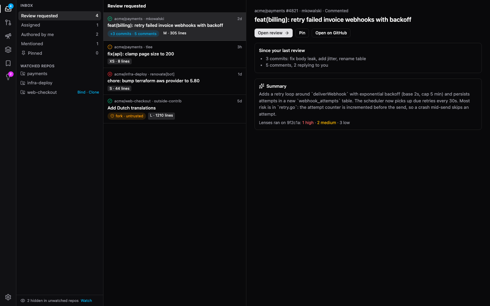
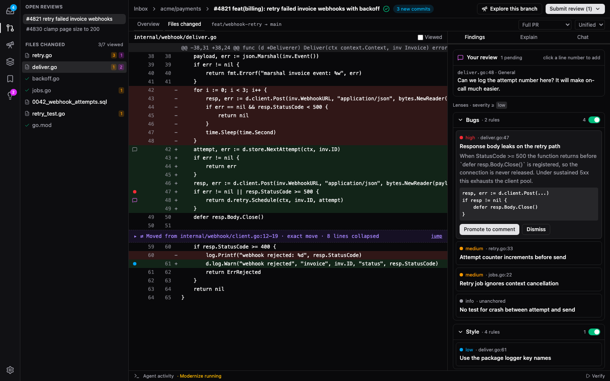
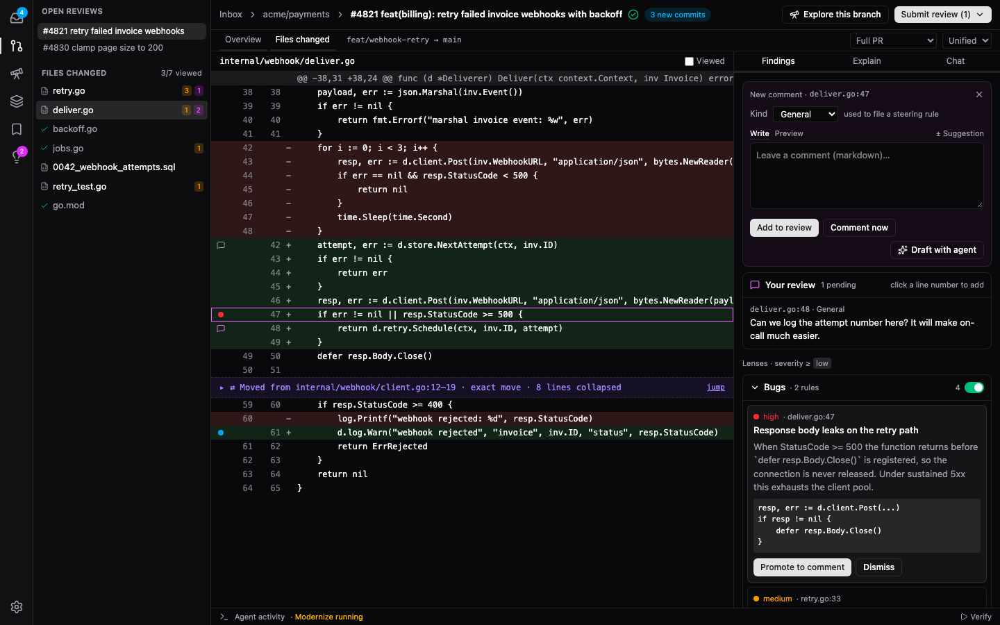
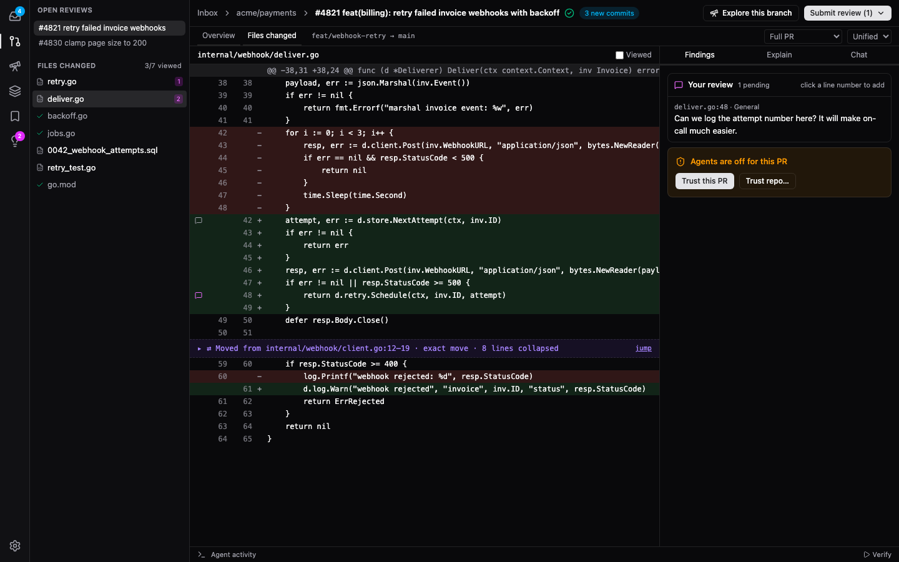
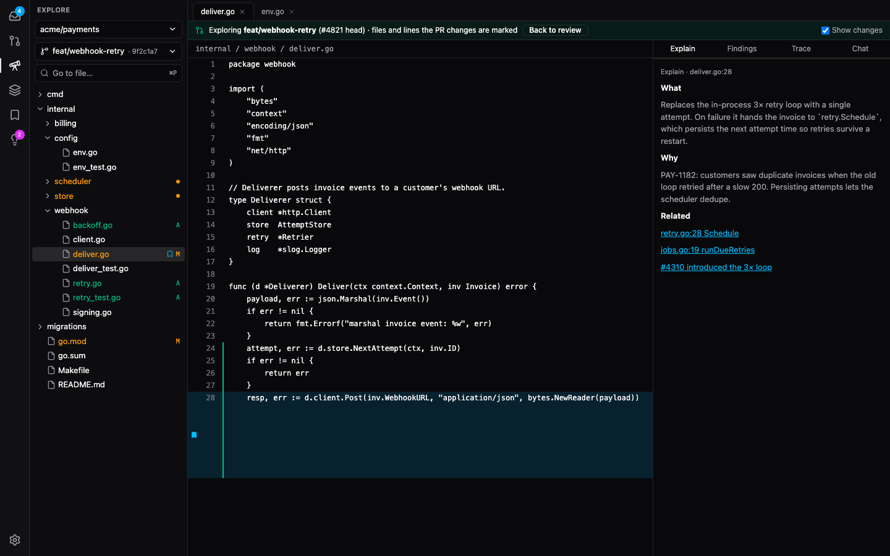
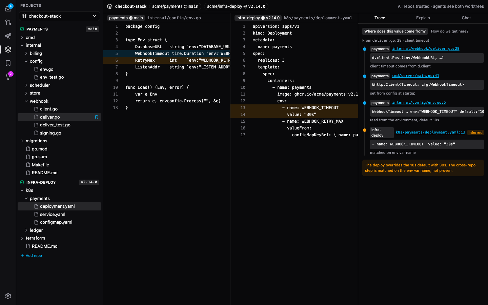
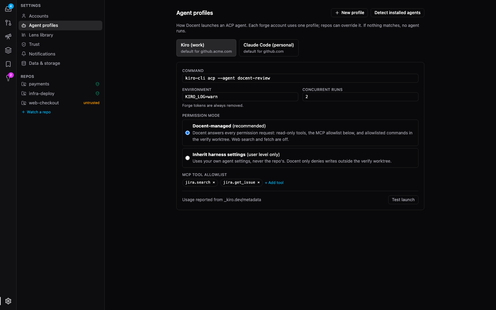

# UI mockups spike: app layout

_November 2026. Settles the app's layout before M1, so the first slices don't each decide a piece of it. The mockups are on the `spike/ui-mockups` branch, which is never merged; paths below under `spike/` refer to that branch._

## Decision

- **App shell:** an **activity bar** down the far left, like VS Code's. Each icon opens a **drawer** next to it with options for that area. Clicking the active icon closes the drawer.
- **Inbox:** **mail split**. Sections and watched repos are in the drawer, the PR list is in the middle, and a preview of the selected PR is on the right.
- **PR review view:** **three panes** as drawn in [`PLAN.md` §5.4](../PLAN.md#54-pr-review-view-m1m4). The file tree is in the drawer, the diff is in the middle, and the agent panel is on the right. Findings appear **only** in the agent panel, grouped by lens, plus dots in the gutter and counts in the tree.

The design covers the whole MVP (M1–M4b) plus Explore and Projects, so the layout shouldn't need reworking as later milestones add to it.

## What was built

A Vue 3 + Tailwind v4 app using shadcn-vue's default colour tokens, with fake data and no backend. It ran in four rounds, each a reaction to the last (`spike/mockups/README.md`):

1. Three structurally different variants each of the PR view (three panes; inline findings with an Explain popover; a triage queue) and the inbox (dense table; mail split; board), switchable from a floating bar, with trusted/untrusted and dark/light toggles.
2. A navigable app from the round 1 winners, inside two shells: an activity bar, and browser-style tabs for comparison. Added Explore and multi-repo Projects.
3. Changes to the review panel: findings grouped by lens with switches, a comment box opened from a line number, and Explore opening the PR's branch.
4. The Settings screen. Lens groups start expanded.

The diff and code views are static stand-ins for CodeMirror 6 in unified view. They draw only what the [M0 spike](viewer-choice.md) showed CodeMirror can do: gutter markers, a `?` at the far right of the hovered line, and moved-block headers.

To run them: `npm --prefix spike/mockups install && npm --prefix spike/mockups run dev`, then open http://localhost:5199.

## The chosen design

### Shell

The activity bar holds **Inbox**, **Review**, **Explore**, **Projects**, **Bookmarks** and **Steering suggestions**, with **Settings** at the bottom. Inbox shows a count of new review requests, and Steering shows a count of suggestions waiting. Bookmarks and Steering open as drawers over whatever page is showing, so they're available everywhere instead of only in the PR view.

You get back to the inbox from the rail, or from the breadcrumb at the top of the review page (`Inbox › acme/payments › #4821`).

### Inbox

The drawer holds the five sections from [§5.2](../PLAN.md#52-inbox-m1) with counts, the watched repos (with **Bind** and **Clone** where there's no local clone), and the "hidden in unwatched repos" line with **Watch**. The preview shows what changed since your last review, the AI summary, lens results on the head commit and, for an untrusted PR, the trust card. **Open review** or a double-click opens the PR.

### PR review view

- **Drawer:** your other open reviews at the top, then the changed files with viewed ✓, finding counts and comment counts.
- **Top bar:** a breadcrumb, CI, "N new commits", **Explore this branch**, and **Submit review (N)**.
- **Agent panel**, with tabs **Findings**, **Explain** and **Chat**. Findings holds:
  - **Your review:** your pending comments.
  - **One group per review lens**, each with its steering rule count, a spinner while it runs, a finding count and an **on/off switch**. Groups start expanded and can be collapsed; a collapsed group shows "N hidden". A switched-off lens can't expand and offers **Run anyway** and **Apply to repo**. The switch also hides that lens's gutter dots.
- **Agent activity** and **Verify** sit in a bar under the diff, which opens into the activity drawer.

### Commenting

Clicking a line number on the new side of the diff outlines the line and opens **New comment** at the top of the Findings tab. It has:

- **Kind:** General or one of the lenses. Steering uses it to file a rule from the comment (see Plan changes).
- **Write**, **Preview** and **± Suggestion**.
- **Draft with agent** ([§5.8](../PLAN.md#58-commenting-and-submitting-reviews-m4)): the agent's rewrite appears under your text with **Use this** or **Keep mine**. Nothing posts automatically.
- **Add to review** or **Comment now**.

### Untrusted PRs

The Findings tab still shows **Your review**, so you can comment before trusting anything. The trust card takes the place of the lens groups. Explain shows the same card.

### Explore

**Explore this branch** on a PR opens Explore at the PR's **head branch**, not the default branch. The point is to see the PR's changes inside the rest of the code:

- The tree shows the whole repo. Files the PR changed are amber `M`, files it added are green `A`, and folders containing changes get a dot.
- Lines the PR changed get a green bar beside the line number.
- A banner names the PR and has **Back to review** and **Show changes**.

Opened from the rail instead, Explore starts on the repo's default branch, with a banner if that branch has an open PR. The agent panel has **Explain**, on-demand **Findings** (run on a file, a selection, or self-review the branch), **Trace** and **Chat**. Bookmarks show as a marker in the line gutter.

### Projects

The drawer is one tree with a root per repo. Each root shows its ref (`payments @ main`, `infra-deploy @ v2.14.0`) and a trusted shield. Files from different repos open side by side. The agent panel opens on **Trace**; a step that crosses repos is marked **inferred**, because the link is a name match (here an env var) rather than something proven.

### Settings

The drawer has app-wide sections, then one entry per watched repo:

- **Accounts:** each host, with its token from `gh` or a PAT.
- **Agent profiles:** launch command, environment, concurrency, **permission mode** (with the Inherit warning from [§5.6](../PLAN.md#56-trust-and-agent-safety-m2)), MCP tool allowlist, and **Test launch**.
- **Lens library:** source (default, your copy, yours), "a newer default is available", pause everywhere, tombstones and **Restore defaults**, and the PR summary switch.
- **Trust:** every trusted repo, branch and fork PR, with **Allow verification** and **Revoke**.
- **Notifications** and **Data & storage:** transcript retention, worktrees with disk use, and **Clear all**.
- **Per repo:** **Clone & agent** (clone path, profile override, auto-run size limits), **Lenses & steering** (lens switches with their rules and token cost, **Promote to global**), and **Trust & verification** (the allowed command list).

## What lost, and why

- **PR view, inline findings:** good for reading a finding in context, but there's no overview of the PR, and the Explain popover covers code.
- **PR view, triage queue:** the closest match to how a review actually goes, but a finding showed up twice (in the queue and above the diff), and there was no visible file tree.
- **Inbox, dense table** and **board:** more clutter than the mail split for the same information.
- **Top tabs** instead of the activity bar: easier to keep several PRs open, but Steering and Bookmarks have no natural home. Open reviews are listed in the Review drawer instead.

## Plan changes

- **Shell:** the activity bar and drawer are added to §5.4. Steering and Bookmarks move to the rail, so they're reachable from every page.
- **Agent panel:** grouped lens switches replace the "lens chips" in §5.4 and §5.13.
- **Comment kind (new):** you choose General or a lens when you write a comment. §5.13's staging uses it to file the steering candidate, instead of guessing the closest lens. Comments without a lens stay General.
- **Explore from a PR** opens the PR's head branch with its changes marked (§5.9).

## Not covered

- Split diff view, the Overview tab, threads and replies, the Submit review menu, the since-last-review interdiff, and moved-code expansion were drawn only in passing or not at all. Their behaviour is already set in `PLAN.md`; their layout fits inside the chosen panes.
- Light mode was only checked in round 1.
- The Explain popover, the triage queue's j/k flow and keyboard navigation in general weren't tested for feel. That happens once real components exist.
